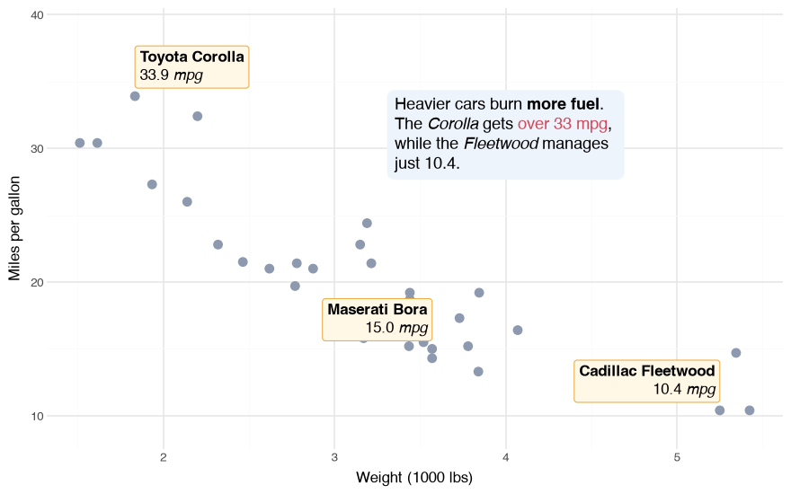

# plotnine-ggtext

Rich text for [plotnine](https://plotnine.org): markdown/HTML formatted labels
and word-wrapped text boxes. A Python port of the two geoms in
[ggtext](https://github.com/wilkelab/ggtext) by Claus O. Wilke, together with
the layout engine from [gridtext](https://github.com/wilkelab/gridtext).


The plot that script makes:



<sub>The demo is recorded with [VHS](https://github.com/charmbracelet/vhs):
`vhs demo/demo.tape` (needs `bat`).</sub>

| ggtext (R) | plotnine-ggtext |
|---|---|
| `geom_richtext()` | `geom_richtext()` |
| `geom_textbox()` | `geom_textbox()` |
| `grid::unit()` | `unit()` |

## Install

```bash
pip install git+https://github.com/snake-case-ggtext/plotnine-ggtext
```

## Usage

```python
import pandas as pd
from plotnine import aes, ggplot, geom_point, xlim, ylim
from plotnine_ggtext import geom_richtext, geom_textbox, unit

df = pd.DataFrame({
    "x": [0.2, 0.7],
    "y": [0.7, 0.3],
    "label": [
        "Some text **in bold**<br>*x*<sup>2</sup> + *C*<sub>*i*</sub>",
        "Lorem ipsum <span style='color:#B97681'>dolor sit</span> amet, "
        "**consectetur** adipiscing elit, sed do *eiusmod tempor*.",
    ],
})

(
    ggplot(df, aes("x", "y"))
    + geom_richtext(aes(label="label"), data=df.iloc[[0]], fill="cornsilk")
    + geom_textbox(aes(label="label"), data=df.iloc[[1]], width=unit(2, "in"))
    + geom_point()
    + xlim(0, 1) + ylim(0, 1)
)
```

### Supported markup

The same subset as gridtext:

- `**bold**`, `*italic*`, `<b>`, `<strong>`, `<i>`, `<em>`
- `<br>` line breaks, blank lines for new paragraphs
- `<sup>`, `<sub>`
- `<span style="color: …; font-size: …; font-family: …">` (sizes in `pt`,
  `px`, `in`, `cm`, `mm`)

Any other tag raises an error. Images (``) are not supported yet.

## Differences from ggtext

plotnine conventions are used where ggplot2 and plotnine differ:

| ggtext | plotnine-ggtext | note |
|---|---|---|
| `label.colour`, `box.size`, … | `label_colour`/`label_color`, `box_size`, … | dots become underscores, for parameters and aesthetics |
| `size = 3.88` (mm) | `size = 11` (pt) | font size in points, as in plotnine's `geom_text` |
| `label.size`, `box.size` (mm) | same, mm | outline width, mm (`× 72.27/25.4` to pt) |
| `fontface` | `fontweight`, `fontstyle` | as in plotnine's `geom_text` |
| `label.colour = NA` | `label_color = "none"` | `None` (the default) means "inherit `color`" |
| `unit(x, "lines")` | `unit(x, "lines")` | 1 line = 14.4 pt, grid's default |
| `scale_discrete_identity(aesthetics = "fill")` | `scale_fill_identity()` | aesthetics without scales (`label_color`, `orientation`) pass through |

Bare numbers passed for padding, margins, radii and sizes are points.

## Tests

```bash
uv run pytest
```

The suite mirrors ggtext's: every `vdiffr::expect_doppelganger()` snapshot in
ggtext's `test-geom-richtext.R` and `test-geom-textbox.R` has a one-to-one
image-comparison test (same data, same parameters), using plotnine's own
baseline-image harness. The R renderings of those plots are in
`tests/reference_r/` (re-create with `Rscript tests/reference_r/render.R`) for
side-by-side comparison. The ports of the roxygen examples, more image tests
and unit tests for the markup parser and layout engine are also included.

To update baselines after an intended visual change:

```bash
uv run pytest --update-baselines
```

## License

GPL-2, the same as ggtext. The layout engine is ported from gridtext (MIT).
